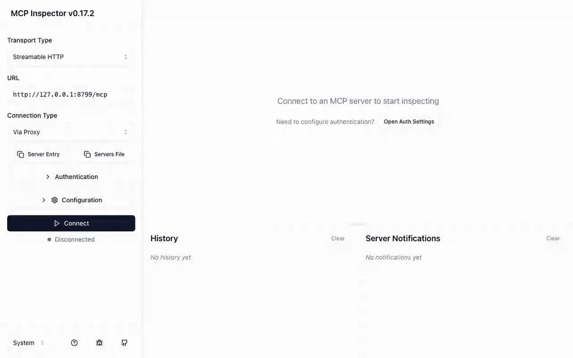

# MCP 閘道

> 指令以 `package.json` 的 `scripts` 與 `wrangler.jsonc` 為準。
>
> [](https://deploy.workers.cloudflare.com/?url=https://github.com/lazyjerry/mcp-gateway)　**按鈕部署完還沒結束**：還要自己加服務綁定、設定 `SERVICES`，否則閘道沒有任何 tool，清單見〈部署〉的方式一。

一個放在獨立網域的 Cloudflare Worker，讓 AI client（Claude Code、claude.ai、Claude Desktop、ChatGPT、Cursor 等）透過 MCP（Model Context Protocol）操作自建的各種服務。

- **對外**：提供 MCP 端點 `/mcp`。
- **授權**：內建 OAuth 2.1 授權伺服器，負責使用者本人的登入，並由使用者逐一勾選每個 client 能用哪些服務、哪些權限。
- **對內**：依授權範圍呼叫各個服務。閘道不保存任何服務的資料，程式裡也不寫任何服務的 tool：有哪些服務、每個服務能做什麼，由服務自己回報。

## 架構

```
AI client ──OAuth / MCP──▶ MCP 閘道 Worker（<閘道網域>）
                            ・OAuth 授權伺服器：登入、同意、發 token
                            ・MCP server：依 token 範圍提供 tools
                               │                         │
                     服務綁定 RPC                   HTTPS + HMAC
                （同一個 Cloudflare 帳號）     （其他帳號或非 Cloudflare）
                               ▼                         ▼
                      同帳號的自建服務            其他自建服務（規劃中）
```

一次呼叫的流程：

1. client 第一次連 `/mcp` 收到 401，依 OAuth metadata 動態註冊並走授權流程。
2. 使用者在閘道登入，在同意頁勾選這個 client 的授權範圍。
3. client 取得 access token，之後帶 token 呼叫 `tools/list`、`tools/call`。
4. 閘道檢查範圍後，透過服務綁定呼叫該服務的 `call()`，再把結果包成 MCP 回應。

## 串接的服務

閘道的程式與設定不含任何實際服務的資訊（串接範例見〈範例：串接書籤服務〉）。有哪些服務、每個服務有哪些 tool 與授權範圍，執行時才知道：

- **服務清單**：secret `SERVICES` 列出服務綁定的 binding 名稱，多個以逗號分隔。binding 宣告在 wrangler 設定的 `services`；repo 裡的 `wrangler.jsonc` 不含任何服務，實際的綁定寫在不進版控的 `wrangler.local.jsonc`。
- **tool 與範圍**：每個服務的 RPC entrypoint 提供 `describe()`，回傳它在同意頁顯示的名稱、授權範圍，以及每個 tool 的名稱、說明、參數的 JSON Schema、標註、需要的範圍。
- **執行**：`tools/call` 轉給該服務的 `call(tool, args, caller)`，回傳值成為 MCP 的 tool 結果。
- **服務名稱**：binding 名稱的小寫，例如 `NOTES` 是 `notes`。服務只能宣告 `notes:` 開頭的範圍與 `notes_` 開頭的 tool，tool 用到的範圍也要是它自己宣告的；不符合的閘道會丟掉，一個服務冒用不了另一個服務的權限。
- **更新**：`describe()` 的結果在同一個 isolate 留 60 秒。服務改了 tool 或範圍，部署後最多一分鐘生效，閘道不必重新部署。

閘道替每個 tool 做的事：

- `tools/list` 依 token 的範圍過濾；沒授權的範圍看不到對應的 tool，直接 `tools/call` 也會被拒絕。
- 執行前依服務宣告的 JSON Schema 驗參數。
- 沒標 `readOnlyHint` 的 tool 套用頻率限制。
- 每次呼叫記一筆稽核紀錄。
- 服務丟出例外時只回固定的說明文字。

連線方式目前只有同一個 Cloudflare 帳號的服務綁定 + `WorkerEntrypoint` RPC，不經公網。其他帳號或非 Cloudflare 的服務規劃用 HTTPS + HMAC（每個服務一把金鑰 `SVC_<服務>_KEY`），還沒有實作。

服務端要提供的契約，以及新增、修改、移除服務串接的步驟，見 [README.dev.md](README.dev.md)。

## 專案結構

```
wrangler.jsonc          通用設定（Deploy Button 與測試用）：kv_namespaces（OAUTH_KV）、d1_databases（DB）、assets（public/）；不含服務，複製成 wrangler.local.jsonc 後填服務綁定
migrations/             閘道 D1：稽核紀錄、登入失敗計數、帳號與授權事件、tool 頻率限制、記住的勾選、Passkey
src/index.ts            OAuthProvider 的 default export，組合 auth 與 mcp
src/auth.ts             登入（密碼、Passkey）、登出、同意頁、設定頁（授權列表、撤銷、記住的勾選、Passkey、稽核紀錄）的路由
src/ui.ts               上面這些頁面與提示訊息的標記，結構照 Jerry UI 元件規格
public/                 頁面用的靜態檔：jerry-ui.css、jerry-ui.js、jerry.png（元件庫，整檔不改）、app.css（稽核紀錄表）
src/session.ts          閘道自己的登入 Session，只用在授權頁與設定頁
src/throttle.ts         登入失敗節流、tool 的頻率限制
src/mcp.ts              MCP server：依 token 範圍組出 tools
src/permissions.ts      權限判斷的唯一來源（tools/list 與 tools/call 共用）
src/audit.ts            稽核紀錄的寫入與保留
src/events.ts           帳號與授權事件（登入、登出、同意、拒絕、撤銷、新增與刪除 Passkey）的寫入與保留
src/passkeys.ts         Passkey（WebAuthn）的新增、登入驗證、刪除；瀏覽器端在 public/passkey.js
src/mailer.ts           通知信：即時通知與每日統計信
src/consents.ts         記住同意頁的勾選，算出重新授權時要預先勾選的範圍
src/services/index.ts   讀 SERVICES、呼叫各服務的 describe() 與 call()、檢查回傳形狀與名稱前綴
scripts/dev.sh          本機開發：閘道與 .dev.services 列出的服務一起跑
scripts/deploy.sh       部署：先套 D1 migration 再部署；有 wrangler.local.jsonc 就用它
test/                   Vitest 測試；test/fixtures/services.js 是範例服務，掛成 auxiliary worker 經服務綁定呼叫
```

不進版控、只存在本機的檔案：`wrangler.local.jsonc`（實際的服務綁定）、`.dev.vars`（機密與 `SERVICES`）、`.dev.services`（本機要一起跑的服務）。

主要依賴：`@cloudflare/workers-oauth-provider`、`agents`（無狀態 `createMcpHandler`，不需要 Durable Objects）、`hono`、`zod`。

## 架設

### 需要的東西

- Cloudflare 帳號，要串接的服務也部署在同一個帳號。
- Node.js 與 Wrangler CLI。
- 給閘道用的網域：可以先用 `workers.dev` 的預設網址，之後再綁自訂網域。

### 本機開發

```bash
npm install
npm test          # 測試：接 repo 內的範例服務，不需要 wrangler.local.jsonc，也不需要任何實際的服務
npm run typecheck # 型別檢查
```

要在本機接實際的服務，先準備三個不進版控的檔案：

```bash
cp wrangler.jsonc wrangler.local.jsonc      # 在 services 填入服務綁定：binding（服務名大寫）、service（Worker 名稱）、entrypoint
cp .dev.vars.example .dev.vars             # 至少填 GATEWAY_PASS；SERVICES 填 binding 名稱，多個以逗號分隔
echo '<服務的 wrangler 設定檔路徑>' >> .dev.services   # 一行一個，本機要一起跑的服務
npm run dev                                # 閘道與 .dev.services 列出的服務一起跑
```

`npm run dev` 的限制：一起跑的服務如果有一律連遠端的 binding（例如 `ai`），Cloudflare 帳號不只一個時，非互動環境會啟動失敗。遇到時替那個服務準備一份拿掉該 binding 的暫時設定檔，改列在 `.dev.services`；各 Worker 共用同一個 `--persist-to` 目錄，D1 migration 對該目錄各套一次。

驗證：用 MCP Inspector 連 `http://localhost:<port>/mcp`，走一次授權流程，再逐一呼叫 tools。

### 部署

兩種方式擇一。不論哪一種，**要串接的服務都要先部署在同一個 Cloudflare 帳號**，並帶著提供 `describe()` 與 `call()` 的 RPC entrypoint，否則閘道問不到它的 tool。

#### 方式一：Deploy Button

[](https://deploy.workers.cloudflare.com/?url=https://github.com/lazyjerry/mcp-gateway)

> **按鈕只部署出一個沒有服務的閘道，部署完還要自己做這幾件事，漏掉的話 AI client 連上後一個 tool 都沒有：**
>
> - [ ] 要串接的服務已部署在同一個 Cloudflare 帳號，並帶著 `describe()` 與 `call()` 的 RPC entrypoint
> - [ ] 在 Cloudflare 幫你建的那份 repo，於 `wrangler.jsonc` 加上 `services`，push 後等 Workers Builds 重新部署（下面第 4 步）
> - [ ] 在 Worker 的 Settings → Variables and Secrets 設定 `SERVICES`，值是上一步的 binding 名稱
> - [ ] 要收通知信的話：設定 `MAIL_FROM`、`MAIL_TO`，並完成 Email Routing 的網域與收件地址驗證（見〈部署之後〉）
> - [ ] 用 AI client 連上 `/mcp` 走一次授權，確認同意頁列出服務的權限

1. 按上面的按鈕，選 Cloudflare 帳號與 Git 帳號。Cloudflare 會在你的 GitHub 或 GitLab 建一份這個 repo，並接上 Workers Builds：之後每次 push 都會重新部署。
2. 部署畫面會自動建立 KV（`OAUTH_KV`）與 D1（`DB`），並請你填 `.dev.vars.example` 列出的 secret：
   - `GATEWAY_PASS`：必填，閘道登入密碼。用 `openssl rand -base64 24` 產生並自己存好。
   - `SERVICES`、`MAIL_FROM`、`MAIL_TO`：選用，還沒有服務、不寄信就留空。
3. 部署指令是 `npm run deploy`（`scripts/deploy.sh`）：先套 D1 migration，再部署 Worker。
4. **加上服務**：服務綁定沒辦法在部署畫面設定，也不能在 Cloudflare 後台手動加（下次部署會被設定檔蓋掉）。到 Cloudflare 幫你建的那份 repo，在 `wrangler.jsonc` 加 `services`：

   ```jsonc
   "services": [{ "binding": "NOTES", "service": "<服務的 Worker 名稱>", "entrypoint": "<WorkerEntrypoint 類別名稱>" }],
   ```

   push 之後 Workers Builds 會自動重新部署。再到 Cloudflare 後台 Worker 的 Settings → Variables and Secrets，把 `SERVICES` 設成 binding 名稱（例如 `NOTES`）。那份 repo 會寫進你的服務名稱，想保密就設成 private。

#### 方式二：從本機部署

```bash
npm install
npx wrangler login
cp wrangler.jsonc wrangler.local.jsonc        # 在 services 填入服務綁定；這份不進版控
```

1. **首次部署**：D1 要等第一次 deploy 才會建立，所以第一次先單獨部署，再套 migration。`wrangler.local.jsonc` 不寫 KV 與 D1 的 id，首次 deploy 依 binding 自動建立，之後沿用。

   ```bash
   npx wrangler deploy -c wrangler.local.jsonc
   npm run deploy                              # 套 D1 migration 後再部署一次
   ```

2. **設定閘道的機密**：密碼設好之前，登入、同意、設定頁都回 503，`/mcp` 回 401。

   ```bash
   openssl rand -base64 24                                         # 產生一組密碼，自己存好
   npx wrangler secret put GATEWAY_PASS -c wrangler.local.jsonc    # 閘道登入密碼，貼上剛才那組
   npx wrangler secret put SERVICES -c wrangler.local.jsonc        # 服務綁定的 binding 名稱，多個以逗號分隔
   npx wrangler secret put SVC_<服務>_KEY -c wrangler.local.jsonc  # 只有走 HMAC 的服務需要
   npx wrangler secret put MAIL_FROM -c wrangler.local.jsonc       # 選用：通知信的寄件地址
   npx wrangler secret put MAIL_TO -c wrangler.local.jsonc         # 選用：通知信的收件地址，多個以逗號分隔
   ```

3. **之後更新**：`npm run deploy`。它有 `wrangler.local.jsonc` 就用它，先套新的 migration 再部署；KV、D1 與已設定的機密都會沿用。多串一個服務時，在 `wrangler.local.jsonc` 加服務綁定、重新設定 `SERVICES`，再部署。

**帳號不只一個時**：在自己的終端機執行，wrangler 會列出帳號讓你選，選服務所在的那一個。腳本或其他非互動環境選不了，要在指令前加 `CLOUDFLARE_ACCOUNT_ID=<帳號 id>`；id 用 `npx wrangler whoami` 查。

#### 部署之後

- `SERVICES` 沒設定時閘道照常運作，只是沒有任何 tool，同意頁也沒有權限可勾。
- **通知信**走 Email Routing：`MAIL_FROM` 的網域要啟用 Email Routing，`MAIL_TO` 的每個地址都要加進 Destination addresses 並點過驗證信。兩個任一個沒設定就不寄信，其他功能不受影響。確認方式：登入一次設定頁，紀錄頁出現「登入成功」，信箱收到同名的通知信；沒收到時看 `npx wrangler tail` 裡的 `mail failed`。
- **自訂網域**（選用）：在 Cloudflare 後台替 Worker 綁定。換網域後 OAuth 的網址跟著變，所有 client 要重新授權。Passkey 也綁 hostname：在 `workers.dev` 與自訂網域要各自新增，換網域後要重新新增。
- **關掉用不到的網址**（建議）：綁好自訂網域後，在 Worker 的 Settings → Domains & Routes 關掉 `workers.dev` 與 Preview URLs，只留一個入口。

### 範例：串接書籤服務

[lazyjerry/bookmark-shelf](https://github.com/lazyjerry/bookmark-shelf) 是照 [README.dev.md](README.dev.md)〈服務端的契約〉實作的服務，可以拿來走一次完整的串接。它的 RPC entrypoint 是 `BookmarkRpc`（在它的 `src/rpc.ts`），Worker 名稱是 `bookmark-shelf`。

1. **部署書籤服務**：照它 README 的〈部署〉，用它的 Deploy Button 或手動部署，部署到與閘道同一個 Cloudflare 帳號。部署時改了 Worker 名稱的話，下一步的 `service` 要填改過的名稱。
2. **在閘道加服務綁定**：按鈕部署的改 Cloudflare 幫你建的那份 repo 裡的 `wrangler.jsonc`，本機部署的改 `wrangler.local.jsonc`：

   ```jsonc
   "services": [{ "binding": "BOOKMARKS", "service": "bookmark-shelf", "entrypoint": "BookmarkRpc" }],
   ```

   按鈕部署的 push 後等 Workers Builds 重新部署；本機部署的執行 `npm run deploy`。
3. **設定 `SERVICES`**：值是 `BOOKMARKS`。按鈕部署的到 Worker 的 Settings → Variables and Secrets 設定；本機部署的執行 `npx wrangler secret put SERVICES -c wrangler.local.jsonc`。服務名稱是 binding 的小寫 `bookmarks`，所以書籤服務只能宣告 `bookmarks:` 開頭的範圍與 `bookmarks_` 開頭的 tool。
4. **選用**：在書籤服務設定 `APP_URL`（書籤服務自己的網址）。經閘道新增書籤時，通知信裡的連結會用它。
5. **確認**：AI client 連上 `/mcp` 走授權。同意頁的「書籤收藏櫃」分組應該列出兩個權限：
   - **查詢書籤**（`bookmarks:read`，預設勾選）：可以用 `bookmarks_search`、`bookmarks_get`、`bookmarks_overview`
   - **新增書籤**（`bookmarks:write`，預設不勾）：可以用 `bookmarks_add`，不能修改或刪除

   只勾查詢的話，`tools/list` 看不到 `bookmarks_add`，直接呼叫也會被拒絕。

範圍與 tool 由書籤服務的 `describe()` 決定，以它的 repo 為準；它改了 tool 後，閘道最多一分鐘就會跟上，不必重新部署。

### 接上 AI client

- **Claude Code**：

  ```bash
  claude mcp add --transport http <名稱> https://<閘道網域>/mcp
  ```

  第一次使用時會開瀏覽器走授權流程；沒有自動開的話，在 Claude Code 輸入 `/mcp`，選這個 server 按 Authenticate。
- **Codex**：

  ```bash
  codex mcp add <名稱> --url https://<閘道網域>/mcp
  codex mcp login <名稱>     # 開瀏覽器授權；沒有自動開就加 --no-browser，照印出的網址操作
  codex mcp list             # 確認已列出且已登入
  ```

  設定寫在 `~/.codex/config.toml` 的 `[mcp_servers.<名稱>]`。要移除時先 `codex mcp logout <名稱>` 再 `codex mcp remove <名稱>`，閘道那邊的授權另外到設定頁撤銷。
- **claude.ai、Claude Desktop、ChatGPT**：在 connector 設定加入 `https://<閘道網域>/mcp`。

每個 client 在閘道上各自授權、各勾各的權限，設定頁會分開列出，可以分開撤銷。

## 使用

### 第一次授權

1. client 連上 `/mcp` 後會開瀏覽器到閘道的登入頁，輸入 `GATEWAY_PASS`，或按「改用 Passkey 登入」。
2. 同意頁列出這個 client 的名稱、同意後會導回的網址，以及可勾選的權限。名稱是 client 自己填的，**以導回的網址為準**，不認得就按拒絕。
3. 勾選要給的權限後按同意。權限依服務分組，每一項的名稱、說明與預設有沒有勾選，都由該服務宣告；通常只有查詢類預設勾選。



上圖是本機的閘道接 repo 內的範例服務 `notes`，用 MCP Inspector 走一次授權：同意頁只勾「查詢記事」，連上後 `tools/list` 只看得到 `notes_list`、`notes_get`，看不到需要 `notes:write` 的 `notes_add`。

授權的有效期是 30 天，到期後 client 會再開一次瀏覽器。要改權限就從 client 重新授權（例如 Claude Code 的 `/mcp` 選該 server 重新驗證），同意後會取代這個 client 原本的授權，不必先撤銷；在同意頁按拒絕則保留原本的授權。

重新授權時，同意頁會照這個 client 上次的勾選預先勾好；上次沒列出的權限（例如新串的服務）照服務的預設。撤銷授權不會清掉上次的勾選，要回到預設就到設定頁清除。client 重新註冊、換了 client_id 時，當成第一次授權。

### 管理已授權的 client

登入 `https://<閘道網域>/settings`，頁面上方的導覽列切換「授權」「紀錄」「設定」：

- **已授權的 client**：列出每個 client 的名稱、權限與授權時間。按「撤銷」後，那個 client 的 token 立刻失效。授權之後才新增的權限（例如新串的服務），卡片上會標「需要重新授權」並列出這些權限；同意頁列過但沒勾的權限不算。
- **記住的勾選**：列出每個 client 上次勾選的權限、最近一次同意的時間、來源 IP 與 User-Agent。按「清除記住的勾選」後，那個 client 下次授權時同意頁回到服務的預設。
- **Passkey**（「設定」，`/settings/account`）：列出已新增的 Passkey，可以逐一刪除。新增時要再輸入一次 `GATEWAY_PASS`，再用 Face ID、Touch ID 或裝置 PIN 驗證。新增之後，登入頁的「改用 Passkey 登入」才能用。
- **稽核紀錄**（`/settings/logs`）：最近 200 筆 tool 呼叫，欄位是時間、client、tool、結果（`ok`／`forbidden`／`throttled`／`error`）、處理時間。保留 30 天。
- **帳號與授權**（同一頁的第二張表）：最近 200 筆登入成功、登入失敗、登入被擋、登出、同意授權、拒絕授權、撤銷授權、新增 Passkey、刪除 Passkey，欄位是時間、事件、client、範圍、來源 IP 與 User-Agent。保留 30 天。
- **通知信**（設定了 `MAIL_FROM` 與 `MAIL_TO` 才有）：登入成功、同意授權、撤銷授權、新增 Passkey、刪除 Passkey 每次寄一封；登入被擋時，同一個來源 IP 每 15 分鐘只寄一封。登入失敗、登出、拒絕授權不即時寄，每天 UTC 00:00（台灣 08:00）彙整過去 24 小時的次數與登入失敗的來源寄一封，沒有資料就不寄。
- **登出**：導覽列的「登出」，每一頁都有。沒登出的話，登入狀態 12 小時後過期。

### 常見狀況

| 狀況 | 原因與處理 |
|---|---|
| 登入頁、設定頁回 503 | 還沒設定 `GATEWAY_PASS`，照〈部署〉設定 `GATEWAY_PASS` |
| 登入回 429「密碼錯誤次數過多」 | 同一個來源 IP 15 分鐘內試了超過 5 次。等 15 分鐘，或執行 `npx wrangler d1 execute mcp-gateway --remote --command "DELETE FROM login_attempts"` 清掉計數 |
| AI 說沒有某個 tool，或回「沒有…的授權範圍」 | 授權時沒勾對應的權限，或權限是授權之後才新增的。讓 client 重新授權並勾選 |
| AI 完全沒有 tool，同意頁沒有任何權限可勾 | `SERVICES` 沒設定、binding 名稱與 wrangler 設定的 `services` 對不上，或服務的 `describe()` 失敗。看 `npx wrangler tail` 裡的 `service binding missing`、`service manifest invalid`、`service describe failed` |
| 某個服務少了幾個 tool 或權限 | 名稱不是該服務名稱開頭，被閘道丟掉。log 有 `service manifest entries dropped` |
| 稽核紀錄出現 `forbidden` | 有 client 呼叫了它沒被授權的 tool；呼叫沒有執行 |
| AI 回「3 秒內只能執行一次寫入動作…請排隊」，稽核紀錄出現 `throttled` | 同一個 client 距離上一次寫入類 tool 不到 3 秒，這次沒有執行。等 3 秒再送，一次只送一個。服務標了 `readOnlyHint` 的 tool 不受限。間隔在 `src/throttle.ts` 的 `TOOL_LIMIT` |
| 要換登入密碼 | 重新執行 `npx wrangler secret put GATEWAY_PASS`。已發出的 token 不會失效，懷疑密碼外流時要到設定頁把 client 逐一撤銷 |

## 安全

- **登入**：閘道有自己的密碼登入（`GATEWAY_PASS`，等時比較）；沒設定時整個授權流程回 503。另可用 Passkey 登入（WebAuthn，RP ID 是請求的 hostname，要求使用者驗證），challenge 存 D1、只能兌換一次、5 分鐘內有效；新增 Passkey 要已登入並再輸入密碼。
- **登入失敗節流**：每個來源 IP 15 分鐘內最多驗 5 次密碼，Passkey 登入與新增 Passkey 時的密碼確認共用同一個計數，存閘道的 D1。
- **`/mcp` 的驗證**：只認 OAuth access token，不認登入 Cookie。
- **權限檢查兩次**：`tools/list` 依範圍過濾，`tools/call` 執行前再檢查一次。
- **服務之間的隔離**：服務只能宣告自己名稱開頭的 tool 與範圍，回傳的形狀不對整個服務就不採用。`SERVICES` 與服務綁定都只有部署的人改得到。
- **參數驗證兩次**：閘道依服務宣告的 JSON Schema 驗一次，服務自己再驗一次；JSON Schema 表達不了的規則只有服務擋得到。
- **tool 的頻率限制**：同一個 OAuth client 兩次寫入類 tool 之間至少隔 3 秒，讀取類不限（依服務有沒有替 tool 標 `readOnlyHint` 判斷）；還在間隔內的呼叫不執行，回 tool 錯誤結果請 client 排隊。時間戳存閘道的 D1，被範圍擋下或參數不合法的呼叫不佔名額。
- **撤銷**：設定頁 `/settings` 列出已授權的 client，可以逐一撤銷。更換 `GATEWAY_PASS` 不會讓已發出的 token 失效。
- **CSRF**：同意頁與設定頁的表單都帶 CSRF token。
- **稽核紀錄**：存閘道的 D1，保留 30 天，在 `/settings/logs` 查看；只記 OAuth client、tool、結果狀態、處理時間，不記請求內容。
- **帳號與授權事件**：同樣存閘道的 D1、保留 30 天；記事件種類、來源 IP、User-Agent（最多 200 字），授權事件另記 client 與範圍。不記密碼、token、授權碼。
- **通知信**：內容只有事件種類、時間、client、範圍、來源 IP、User-Agent；寄信失敗只留 log，不影響登入與授權。
- **錯誤訊息**：回給 client 的錯誤只有說明文字，不含堆疊與內部路徑。

## 開發

開發規則見 [AGENTS.md](AGENTS.md)；服務端的契約與新增、修改、移除服務串接的步驟見 [README.dev.md](README.dev.md)。

## 授權

[MIT](LICENSE)
